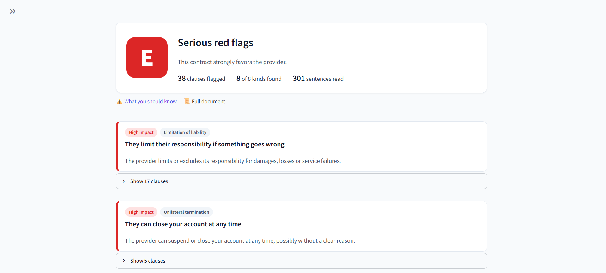
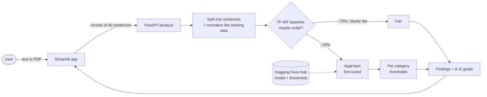

# ⚖️ Clausula

[](https://github.com/DaviiSouza/clausula/actions/workflows/ci.yml)
[](https://huggingface.co/DaviiiiS/clausula-legal-bert)

**Know what you're agreeing to.** Paste any Terms of Service (or upload a PDF) and Clausula flags the clauses that could work against you, explains each one in plain language and grades the contract from **A (fair)** to **E (serious red flags)**.

### 👉 [Try it live](https://clausula-705229120833.us-central1.run.app)

<sub>Runs on a free CPU instance that sleeps when idle: the first visit may take up to a minute to wake up.</sub>



*TikTok's Terms of Service: 301 sentences read, 38 clauses flagged, all 8 kinds of potentially unfair clause found.*

## Why

Almost nobody reads Terms of Service, but they often include clauses that let the provider close your account at any time, change the rules without asking, or take away your right to go to court. Clausula surfaces those clauses in seconds, using categories defined by legal researchers ([CLAUDETTE](https://arxiv.org/abs/1805.01217)):

| Impact | Category | What it means for you |
|---|---|---|
| 🔴 High | Arbitration | You give up your right to go to court |
| 🔴 High | Limitation of liability | They limit their responsibility if something goes wrong |
| 🔴 High | Unilateral termination | They can close your account at any time |
| 🟠 Medium | Unilateral change | They can change the terms whenever they want |
| 🟠 Medium | Content removal | They can delete your content without notice |
| 🟠 Medium | Jurisdiction | Disputes go to courts they choose |
| 🟡 Low | Choice of law | A law chosen by them governs the contract |
| 🟡 Low | Contract by using | Just using the service means you accept the terms |

## How it works



Everything runs in one container on **Google Cloud Run** (scales to zero, max 1 instance). The model is downloaded from the **Hugging Face Hub** at build time.

## Results

Trained and evaluated on [LexGLUE `unfair_tos`](https://huggingface.co/datasets/coastalcph/lex_glue): ~9.4k sentences from 50 real Terms of Service, labeled with the 8 categories. Only ~11% of sentences are unfair, so accuracy is meaningless (always answering "fair" scores 89%). The main metric is **macro-F1**.

| Model | macro-F1 (test) | ms / sentence |
|---|---|---|
| Always "fair" | 0.000 | – |
| TF-IDF + Logistic Regression | 0.765 | ~0.04 (CPU) |
| distilroberta-base, fine-tuned | 0.778 | ~1.5 (GPU) |
| legal-bert-base-uncased, fine-tuned (3 seeds) | 0.782 ± 0.006 | ~3 (GPU) · ~280 (1 CPU) |
| **Cascade: baseline → legal-bert (deployed)** | **0.785** | **~28 (1 CPU)** |

What I learned along the way:

- **The transformer only won after fixing a mismatch.** The first run (cased distilroberta, 5 epochs) *lost* to the baseline (0.721). The data is lowercased legal text, so an uncased legal-domain model trained for longer did better.
- **The gain is real but small.** legal-bert beat the baseline with all 3 seeds, but a paired bootstrap shows the gap is not statistically significant on this test set (95% CI of the difference: [−0.045, +0.075]). It wins where meaning matters more than keywords (*Jurisdiction* +0.14, *Limitation of liability* +0.07). See [`03_model_comparison`](notebooks/03_model_comparison.ipynb).
- **Making it fast enough for a free CPU.** legal-bert alone took 2+ minutes on TikTok's ToS and timed out. Now the baseline screens every sentence, only ~25% reach legal-bert, and batches group sentences of similar length. Result: **~10× faster with the same quality** (gate chosen on validation, confirmed on test). Int8 quantization was tried and rejected: it dropped macro-F1 from 0.875 to 0.714 on a sample. See [`04_cascade`](notebooks/04_cascade.ipynb).

## Run locally

```bash
python3 -m venv .venv && source .venv/bin/activate
pip install -r requirements-dev.txt && pip install -e .

uvicorn api.main:app                 # API → http://localhost:8000/docs
streamlit run app/streamlit_app.py   # app → http://localhost:8501 (another terminal)
pytest                               # tests
```

Or with Docker: `docker compose up --build`.

`CLAUSULA_BACKEND` selects the model: `cascade` (default), `legal-bert` or `baseline`. Models load from `./models` if present, otherwise from the [Hugging Face Hub](https://huggingface.co/DaviiiiS/clausula-legal-bert). To retrain: `python -m clausula.train_transformer --model nlpaueb/legal-bert-base-uncased --epochs 10`.

### API

```bash
curl -X POST localhost:8000/analyze -H "Content-Type: application/json" \
  -d '{"text": "We may terminate your account at any time, for any reason."}'
```

`POST /analyze` (text) and `POST /analyze/pdf` (file upload) return each flagged clause with its categories, confidence scores and a plain-language explanation, plus the A–E grade.

## Project structure

```
src/clausula/   data loading, text normalization, models (baseline, transformer, cascade), metrics, training
api/            FastAPI service
app/            Streamlit app
notebooks/      01 EDA · 02 baseline · 03 model comparison · 04 cascade
tests/          unit, API and headless app tests (no model needed, they run in CI)
deploy/         all-in-one image + Cloud Run / HF Spaces scripts
```

## Limitations

- **English only**, trained on ToS of ~50 large online services. Other contract types may behave differently.
- Rare categories have few examples (Arbitration: 28 training sentences), so their predictions are less reliable.
- The A–E grade and the impact levels are an editorial choice, not a legal standard.
- **Not legal advice.** Clausula is a starting point for reading, not a legal assessment.

## Roadmap

- [x] EDA, TF-IDF baseline, fine-tuned transformer, statistical comparison
- [x] FastAPI + Streamlit, tests, Docker, CI
- [x] Fast CPU inference (cascade) and deploy on Cloud Run
- [ ] LLM zero-shot comparison (cost / latency / quality)
- [ ] Portuguese support (Brazilian consumer law, CDC art. 51)
